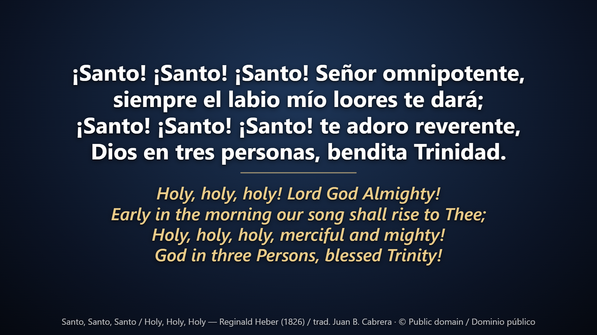
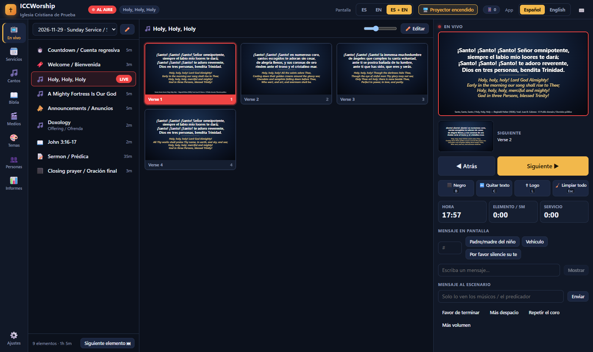
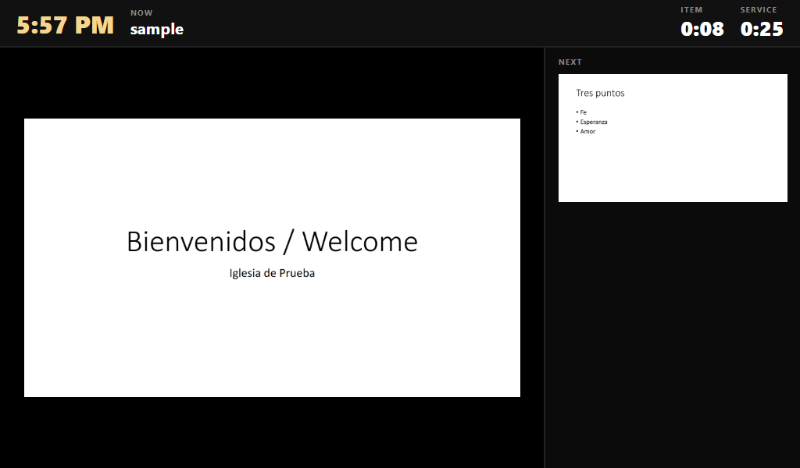
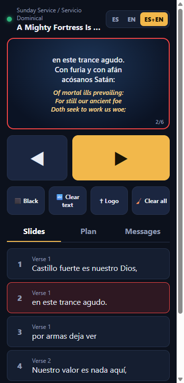
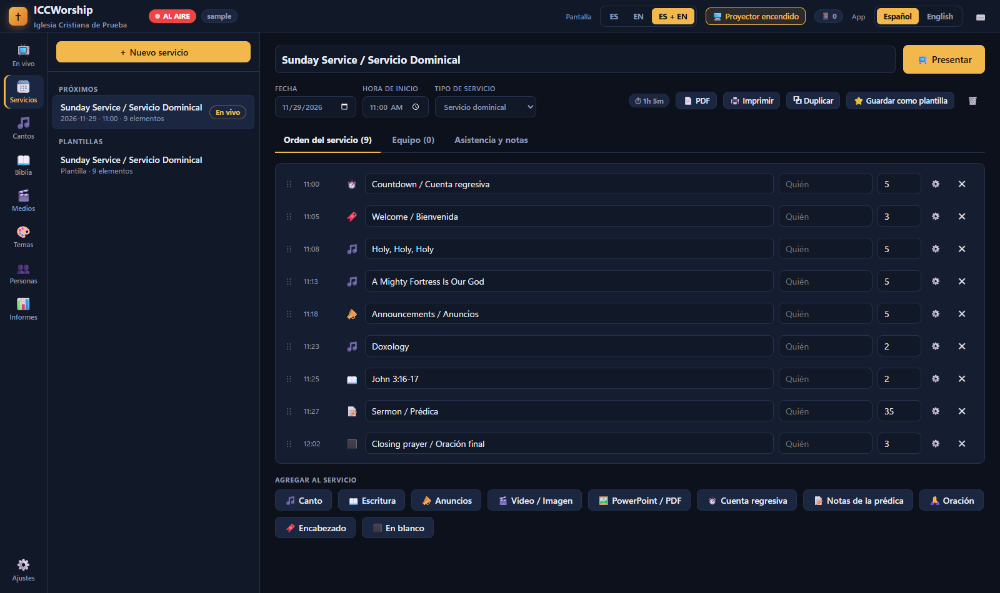
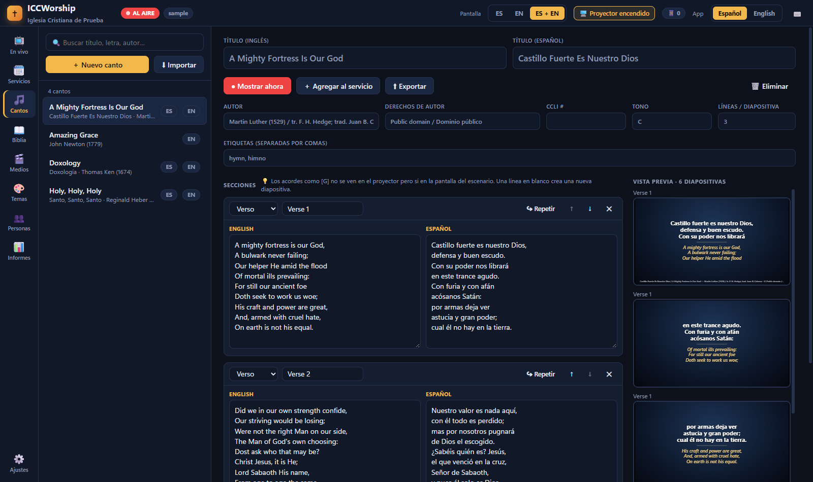
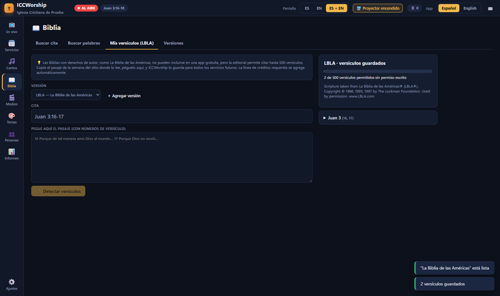

  

<h1 align="center">ICCWorship</h1>

  <b>Software libre y gratuito de presentaciones para la iglesia en Windows — hecho en español e inglés desde el primer día.</b> 
  Cantos · Biblia · Videos · PowerPoint · Planificación del servicio · Control desde el teléfono · Pantalla de escenario 
  <a href="README.md">🇺🇸 Read in English</a>

  

---

## ¿Por qué ICCWorship?

La mayoría de las iglesias pagan cada año por software de presentaciones (EasyWorship, ProPresenter,
Proclaim) y de planificación (Planning Center). Muchas iglesias — sobre todo congregaciones pequeñas y
bilingües — simplemente no lo pueden pagar. **ICCWorship es gratis para siempre**, funciona
**sin internet** y trata **el español y el inglés por igual**: cada canto, versículo y anuncio se puede
mostrar en un idioma o **en ambos a la vez**, cambiando en vivo con una sola tecla.

| Inspirado en | Lo que hace ICCWorship |
|---|---|
| ProPresenter | Monitores En vivo + Siguiente, capas (negro / quitar texto / logo), **pantalla de escenario** con acordes y cronómetros, **control remoto por Wi-Fi**, mensajes en pantalla (llamados de la guardería) |
| EasyWorship / Proclaim | Biblioteca de cantos con búsqueda instantánea, importación de letras, escribir una cita y proyectarla, temas y fondos en movimiento, cuentas regresivas, anuncios en bucle |
| Planning Center Services | Orden del servicio con horas, duraciones y notas, plantillas, **cronómetro por elemento**, programación de voluntarios con aviso de conflictos, programa impreso |
| OpenLP / FreeShow | Gratis y sin internet, importa cantos **OpenLyrics** y **ChordPro** |
| CCLI | Número CCLI en las diapositivas e **informe automático de uso de cantos** (CSV) |

## Funciones

**En pantalla**
- 🎵 **Cantos bilingües** – español e inglés lado a lado en el editor; en pantalla ES, EN o **ES + EN** (teclas `1` `2` `3`). Arreglos (V1 C V2 C P C), líneas por diapositiva, texto que se ajusta solo.
- 📖 **Biblia** – Reina-Valera 1909 y King James incluidas. Escriba `Juan 3:16-18`, `Jn 3.16`, `1 Cor 13`, `Salmos 23` en cualquier idioma → diapositivas bilingües en paralelo; los versículos largos se dividen solos.
- ⭐ **La Biblia de las Américas (LBLA) y otras Biblias con derechos** – vea [abajo](#biblias-con-derechos-de-autor-lbla-nvi-rvr1960).
- 🎬 **Video** – MP4 / MOV / WebM como elemento del servicio (reproducir, pausar, adelantar, volumen, repetir, pasar al siguiente, tiempo restante) **o como fondo en movimiento detrás de la letra**. No hay que instalar códecs.
- 📊 **PowerPoint y PDF** – arrastre un `.pptx`. Con PowerPoint instalado se ve *exactamente* igual; con LibreOffice se convierte; sin ninguno, se importa el texto como diapositivas editables (¡y traducibles!). Las notas del orador van a la pantalla del escenario.
- 📣 Anuncios (con avance automático), ⏱ cuenta regresiva para el inicio, 📝 notas de la prédica con **espacios en blanco que se revelan**, 🙏 diapositivas de oración.
- 🎨 Temas – fuentes, colores, sombras, posición, degradados, fondos de imagen o video; un tema verde de **tercio inferior para transmisiones** (chroma key en OBS).
- 💬 Mensajes en pantalla – un clic para “Padre/madre del niño #12, favor de pasar a la guardería” en ambos idiomas.

**Durante el servicio**
- 📺 Página En vivo: el servicio a la izquierda, las diapositivas al centro, monitores En vivo + Siguiente y botones grandes a la derecha.
- 📱 **Control desde el teléfono** – escanee el código QR, escriba el PIN y controle las diapositivas desde cualquier teléfono en el Wi-Fi de la iglesia.
- 🎤 **Pantalla de escenario** – diapositiva actual/siguiente, acordes, reloj, cronómetros, tiempo restante del video y mensajes desde la cabina (“Favor de terminar”). Ábrala en una tercera pantalla o en cualquier navegador de la red.
- ⌨️ Funciona con teclado y control de presentaciones (Espacio, flechas, RePág/AvPág, B, C, L, Esc, P).

**Planificación y personas**
- 🗓️ Servicios con hora de cada elemento, duraciones, quién dirige, notas, plantillas, duplicar el de la semana pasada.
- 👥 Directorio, equipos y puestos, programación de voluntarios con aviso de conflictos.
- 🙏 Peticiones de oración (las privadas nunca salen en pantalla).
- 📊 Registro de asistencia y ofrendas con resumen mensual; CSV de uso de cantos para CCLI.
- 🖨️ Programa bilingüe → PDF o impresora.

**Sus datos, seguros**
- Todo se guarda en `Documentos\ICCWorship` como JSON — sin nube, sin cuentas.
- Copia automática diaria (guarda 14) + **copia a USB** (.zip) con un clic, y restauración.

## Capturas

| En vivo | Escenario | Teléfono |
|---|---|---|
|  |  |  |

| Servicio | Editor de cantos | Versículos LBLA |
|---|---|---|
|  |  |  |

## Instalación

1. Descargue **`ICCWorship-Setup-x.y.z.exe`** (instalador) o **`ICCWorship-Portable-x.y.z.exe`** (no necesita instalación) en la página de Releases.
   La versión portátil guarda sus datos en la PC donde se usa (`Documentos\ICCWorship`), no en la memoria USB.
2. Windows SmartScreen puede advertir porque la app no tiene firma digital (los certificados cuestan dinero). Haga clic en **Más información → Ejecutar de todas formas**.
3. La primera vez que use el control desde el teléfono, el Firewall de Windows pedirá permiso — elija **Permitir** en redes privadas.

## Sus datos y copias de seguridad

- Todo lo que crea ICCWorship está en **`Documentos\ICCWorship`** (Ajustes → Copia de seguridad → 📂 Abrir carpeta de datos).
- Cada día se hace una copia automática (se guardan las últimas 14 en `Documentos\ICCWorship\backups`).
- **Cambiar de computadora:** en la PC anterior, Ajustes → Copia de seguridad → **Hacer copia ahora** a una memoria USB.
  Instale ICCWorship en la nueva PC y elija **Restaurar** con ese archivo. Los videos e imágenes que agregó se
  *referencian*, no se copian: copie también esos archivos.
- No se sube nada a ningún lugar — vea [PRIVACY.md](PRIVACY.md).

## Su primer domingo (5 minutos)

1. Abra ICCWorship y escriba el nombre de su iglesia. Se crea un servicio de ejemplo con himnos de dominio público.
2. Conecte el proyector/TV. La ventana del proyector se abre en pantalla completa automáticamente (elija la pantalla en **Ajustes → Pantallas**).
3. Vaya a **Servicios** y ajuste el servicio del domingo: agregue cantos, escrituras, videos, un PowerPoint.
4. Presione **Presentar**. Doble clic en un elemento para ponerlo en pantalla y luego **Espacio** para avanzar.
5. Opcional: en **Ajustes**, escanee el código QR con su teléfono para controlar las diapositivas desde cualquier lugar.

Presione **?** en cualquier momento para ver todos los atajos de teclado.

## Biblias con derechos de autor (LBLA, NVI, RVR1960…)

Las traducciones modernas más populares tienen derechos de autor, así que su texto completo **no** puede
incluirse en una app gratuita. ICCWorship incluye dos Biblias completas de dominio público (Reina-Valera 1909
y King James) y ofrece una **versión “para pegar”** para todo lo demás:

1. **Biblia → Mis versículos → Configurar La Biblia de las Américas (LBLA)**.
2. Cada semana copie el pasaje del sitio donde lee la LBLA, péguelo, presione **Detectar versículos** → **Guardar**.
3. Los versículos se guardan solo en esa computadora y se reutilizan automáticamente cada vez que se muestra esa cita — incluso junto a la KJV.
4. La línea de créditos que exige The Lockman Foundation se agrega automáticamente, y un contador vigila el límite de **500 versículos** que Lockman permite sin permiso escrito.
5. Si su iglesia obtiene permiso escrito / un archivo digital con licencia, impórtelo en **Biblia → Versiones** y el límite desaparece.

Lo mismo funciona para NVI, RVR1960, NIV o cualquier otra versión.

## Desarrollo

Requisitos: Windows 10/11, [Node.js](https://nodejs.org) 22.12 o más nuevo y Git.
Vea la sección **Develop** del [README en inglés](README.md#develop): `npm install`, `npm run dev`,
`npm test`, `npm run build:win`.

## Contribuir

Reportes de errores, traducciones, cantos de dominio público y pull requests son bienvenidos — vea
[CONTRIBUTING.md](CONTRIBUTING.md).

- Preguntas: [Discussions](https://github.com/nunez1822/ICCWorship/discussions) · Ayuda: [SUPPORT.md](SUPPORT.md)
- Problemas de seguridad: repórtelos en privado, vea [SECURITY.md](SECURITY.md)
- Esperamos que todos sigan el [Código de conducta](CODE_OF_CONDUCT.md). Novedades: [CHANGELOG.md](CHANGELOG.md)

## Licencia

[MIT](LICENSE) — libre para usar, compartir y modificar, para cualquier iglesia, para siempre.

*Soli Deo gloria.*
