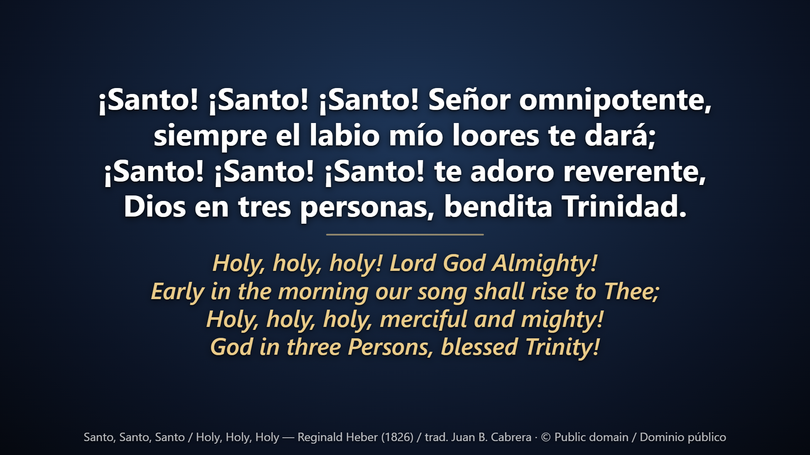
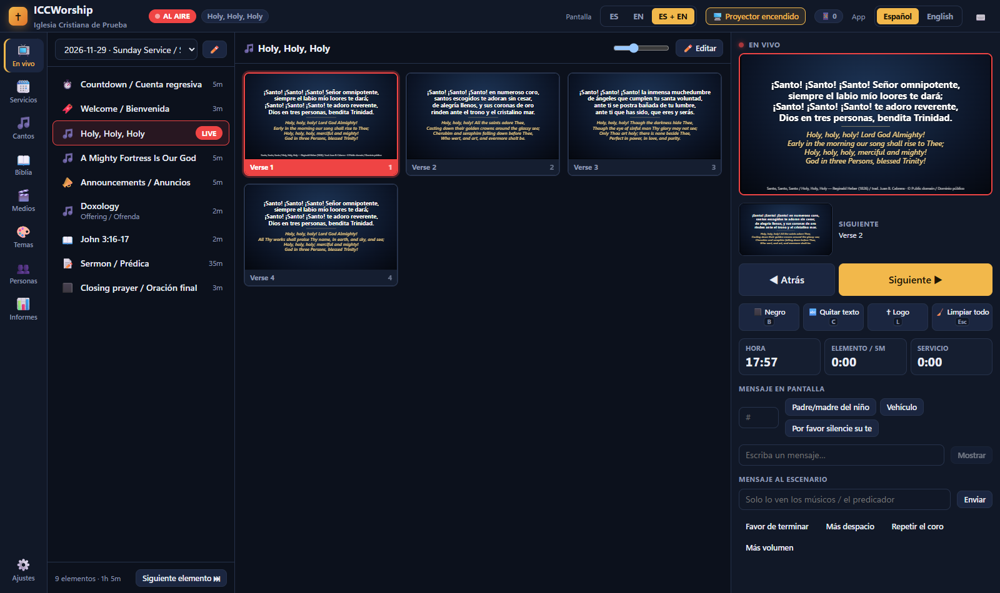
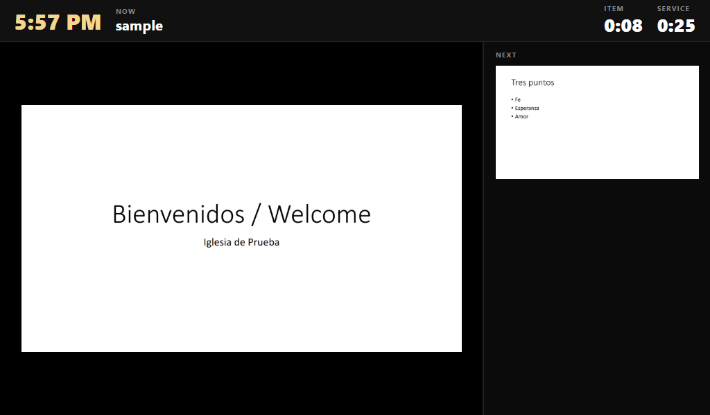
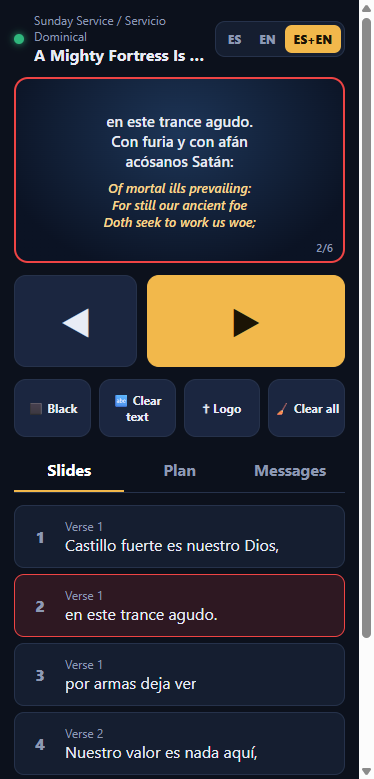
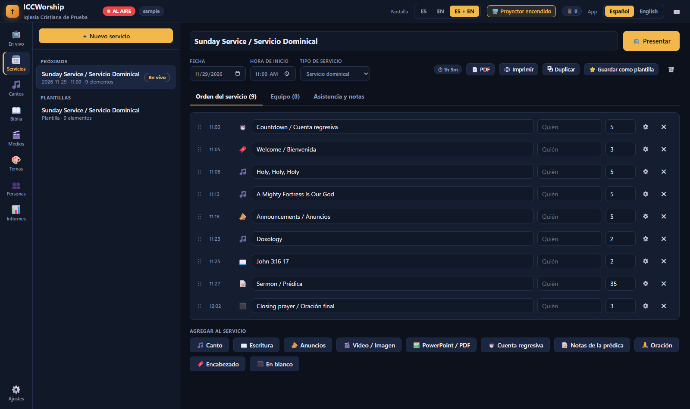
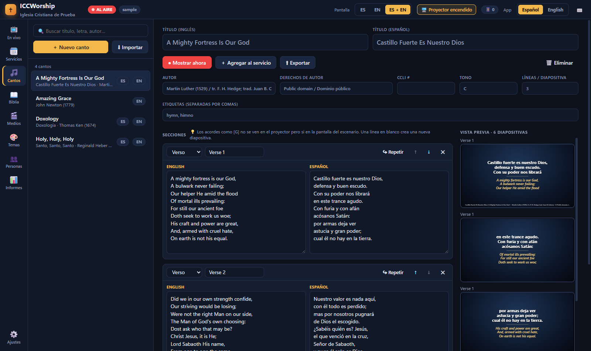
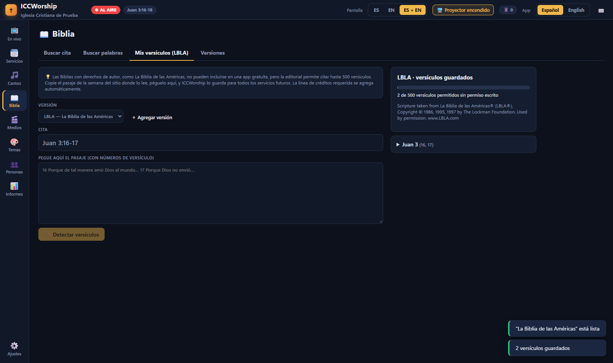

<p align="center">
  
</p>

<h1 align="center">ICCWorship</h1>

<p align="center">
  <b>Free, open-source church presentation software for Windows — built English + Spanish from day one.</b><br/>
  Lyrics · Scripture · Videos · PowerPoint · Service planning · Phone remote · Stage display<br/>
  <a href="README.es.md">🇪🇸 Leer en español</a>
</p>

<p align="center">
  
</p>

---

## Why ICCWorship?

Most churches pay every year for presentation software (EasyWorship, ProPresenter, Proclaim) and
planning tools (Planning Center). Many churches — especially small, bilingual congregations — simply
can't afford it. **ICCWorship is free forever**, works **completely offline**, and treats **Spanish and
English as equals**: every song, verse and announcement can be shown in one language or **both at the
same time**, switchable live with one key.

| Inspired by | What ICCWorship does |
|---|---|
| ProPresenter | Live + Next monitors, layers (black / clear text / logo), **stage display** for musicians with chords & timers, **phone remote over Wi-Fi**, on-screen messages (nursery calls) |
| EasyWorship / Proclaim | Song library with instant search, lyric import, type-a-reference scripture, themes & motion backgrounds, countdowns, announcement loops |
| Planning Center Services | Order of service with start times, durations & notes, templates, **live item timer**, team scheduling with conflict warnings, printable run sheet |
| OpenLP / FreeShow | Free & offline, imports **OpenLyrics** and **ChordPro** songs |
| CCLI | CCLI # on slides and an automatic **song-usage report** (CSV) |

## Features

**On screen**
- 🎵 **Bilingual songs** – English and Spanish side by side in the editor; on screen show ES, EN or **ES + EN stacked** (keys `1` `2` `3`). Arrangements (V1 C V2 C B C), lines-per-slide, auto-fit text.
- 📖 **Bible** – King James and Reina-Valera 1909 built in. Type `Juan 3:16-18`, `Jn 3.16`, `1 Cor 13`, `Salmos 23` in either language → parallel bilingual slides, long verses split automatically.
- ⭐ **La Biblia de las Américas (LBLA) & other copyrighted Bibles** – see [below](#copyrighted-bibles-lbla-nvi-rvr1960).
- 🎬 **Video** – MP4 / MOV / WebM as a service item (play, pause, seek, volume, loop, auto-next, time-remaining) **or as a looping motion background behind lyrics**. No codecs to install.
- 📊 **PowerPoint & PDF** – drag a `.pptx` in. With PowerPoint installed slides look *exactly* like the original; with LibreOffice they're converted; with neither, the text is imported as editable (translatable!) slides. Speaker notes go to the stage display.
- 📣 Announcements (with auto-advance loops), ⏱ countdown to service start, 📝 sermon notes with **fill-in-the-blank reveal**, 🙏 prayer slides.
- 🎨 Themes – fonts, colors, shadows, position, gradients, image or video backgrounds; a green-screen **lower-third theme for livestreams** (chroma key in OBS).
- 💬 On-screen messages – one click for “Parent of child #12, please come to the nursery” in both languages.

**Running the service**
- 📺 Live page: plan on the left, slide grid in the middle, Live + Next monitors and big controls on the right.
- 📱 **Phone remote** – scan a QR code, enter the PIN, control slides from any phone on the church Wi-Fi.
- 🎤 **Stage display** – current/next slide, chords, clock, item & service timers, video time left, and messages from the booth (“Please wrap up”). Open it on a third screen or any browser on the network.
- ⌨️ Keyboard & clicker friendly (Space, arrows, PageUp/PageDown, B, C, L, Esc, P).

**Planning & people**
- 🗓️ Service plans with start times per item, durations, who's leading, notes, templates, duplicate last week.
- 👥 People directory, teams & positions, per-service volunteer schedule with conflict warnings.
- 🙏 Prayer requests (private ones never go on screen).
- 📊 Attendance & offering log with monthly summary; CCLI song-usage CSV.
- 🖨️ Bilingual run sheet → PDF or printer.

**Safe with data**
- Everything lives in `Documents\ICCWorship` as plain JSON — no cloud, no account.
- Automatic daily backup (keeps 14) + one-click **Backup to USB** (.zip) and restore.

## Screenshots

| Live | Stage display | Phone remote |
|---|---|---|
|  |  |  |

| Service plan | Song editor | LBLA verses |
|---|---|---|
|  |  |  |

## Install

1. Download **`ICCWorship-Setup-x.y.z.exe`** (installer) or **`ICCWorship-Portable-x.y.z.exe`** (no installation needed) from the Releases page.
   The portable version still keeps its data on the PC it runs on (`Documents\ICCWorship`), not on the USB stick.
2. Windows SmartScreen may warn because the app is not code-signed (signing certificates cost money). Click **More info → Run anyway**.
3. The first time you use the phone remote, Windows Firewall asks to allow ICCWorship — choose **Allow** on private networks.

## Your data and backups

- Everything ICCWorship creates lives in **`Documents\ICCWorship`** (Settings → Backup → 📂 Open data folder).
- A backup is made automatically each day ICCWorship is opened (the last 14 of those are kept in
  `Documents\ICCWorship\backups`).
- **Moving to a new computer:** on the old PC, Settings → Backup → **Back up now** to a USB stick. Install ICCWorship
  on the new PC and choose **Restore** with that file. Videos and images you added (including the logo and theme
  backgrounds) are *referenced by their full folder path*, not copied: copy them to the **same folder path** on the
  new PC (for example `C:\Users\Pastor\Videos`), or add them again from the Media page and re-pick the logo and
  backgrounds.
- Nothing is uploaded anywhere — see [PRIVACY.md](PRIVACY.md).

## Your first Sunday (5 minutes)

1. Open ICCWorship and type your church name. A sample service with public-domain hymns is created.
2. Connect the projector/TV. The projector window opens full-screen on it automatically (choose the screen in **Settings → Screens**).
3. Go to **Plans**, adjust this Sunday's service: add songs, scripture, videos, a PowerPoint.
4. Press **Present**. Double-click an item to put it on screen, then press **Space** to advance.
5. Optional: in **Settings**, scan the QR code with your phone to control the slides from anywhere in the room.

Press **?** at any time to see all keyboard shortcuts.

## Copyrighted Bibles (LBLA, NVI, RVR1960…)

Popular modern translations are copyrighted, so their full text **cannot** be shipped in a free app.
ICCWorship includes two complete public-domain Bibles (KJV and Reina-Valera 1909) and offers a
**“paste-in” version** for everything else:

1. **Bible → My Bible verses → Set up La Biblia de las Américas (LBLA)**.
2. Each week, copy the passage from the website where you read LBLA, paste it in, press **Detect verses** → **Save**.
3. The verses are stored on that computer only and reused automatically whenever that reference is shown — even side by side with the KJV.
4. The Lockman Foundation's required credit line is added automatically, and a counter tracks the **500-verse** limit Lockman allows without written permission.
5. If your church obtains written permission / a licensed digital file, import it in **Bible → Versions** and the limit disappears.

The same works for NVI, RVR1960, NIV or any other version.

## Develop

Requirements: Windows 10/11, [Node.js](https://nodejs.org) 22.12+ and Git.

```bash
npm install            # install dependencies (downloads Electron)
npm run dev            # run with hot reload
npm test               # unit tests (scripture parser, slides, importers, translations…)
npm run build          # production bundle in out/
npm run smoke          # launches the built app and clicks through a whole service, saving screenshots
npm run build:win      # Windows installer + portable exe in dist/
npm run bibles         # rebuild resources/bibles/*.json from the open-bibles project
```

If `npm install` skipped Electron's download, run `node node_modules/electron/install.js`.

**Tech:** Electron + React + TypeScript (electron-vite), Zustand, i18next, plain JSON storage,
a tiny `http` + `ws` server for the remote/stage, pdf.js, JSZip. No native modules — it builds
without Visual Studio.

```
src/
  shared/     pure logic shared by everything (bible books & reference parser, slide builder,
              song importers, PowerPoint text reader, defaults & types) — fully unit tested
  main/       Electron main process: windows & displays, JSON store, Bible service, live state,
              LAN server (stage/remote), PowerPoint/PDF conversion, backups, printing
  preload/    the typed `window.api` bridge
  renderer/   operator UI (operator/), projector (output/), stage display (stage/), phone remote (remote/)
              translations in renderer/i18n/en.json + es.json
tests/        Vitest tests (+ a real .pptx fixture)
scripts/      Bible builder, smoke test, icon renderer
```

### Adding a translation / language
All UI text lives in `src/renderer/i18n/en.json` and `es.json`. A test fails if the two files ever
have different keys or if the code uses a key that doesn't exist — so nothing ships half-translated.

## Contributing

Bug reports, translations, songs in the public domain and pull requests are very welcome — see
[CONTRIBUTING.md](CONTRIBUTING.md). Please don't add copyrighted lyrics or Bible texts to the repository.

- Questions: [Discussions](https://github.com/nunez1822/ICCWorship/discussions) · Help: [SUPPORT.md](SUPPORT.md)
- Security problems: report privately, see [SECURITY.md](SECURITY.md)
- Everyone is expected to follow the [Code of Conduct](CODE_OF_CONDUCT.md). What's new: [CHANGELOG.md](CHANGELOG.md)

## License

[MIT](LICENSE) — free to use, share and modify, for any church, forever.
KJV and Reina-Valera 1909 texts are in the public domain (via [open-bibles](https://github.com/seven1m/open-bibles)).

*Soli Deo gloria.*
